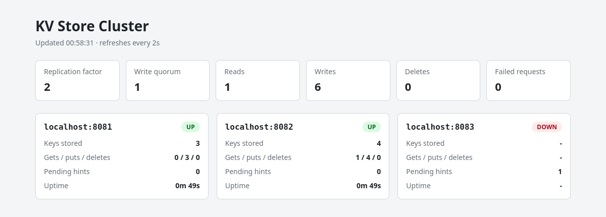

# Distributed Key-Value Store

[](https://github.com/rishit-exe/distributed-kv-store/actions/workflows/ci.yml)

A distributed key-value storage system built from scratch in Java to explore
distributed systems, concurrency, networking, partitioning, replication,
fault tolerance, and system design.

The Java code uses only the JDK (no frameworks or libraries at runtime): the
HTTP server, the storage engine, consistent hashing, replication and failure
handling are all written by hand.



## Features

- **Storage engine**: in-memory `ConcurrentHashMap` backed by an append-only
  write-ahead log with CRC32 checksums, crash recovery and log compaction
- **HTTP API**: `GET` / `PUT` / `DELETE` on `/kv/{key}`, served by a thread pool
- **Partitioning**: consistent hash ring with 100 virtual nodes per node
- **Replication**: every key on N nodes (default 2), configurable write quorum W
- **Failure detection**: heartbeat health checks every second, a node is
  marked DOWN after 3 misses or on the first failed request
- **Node recovery**: hinted handoff. Writes a node missed are queued and
  replayed in order before it serves reads again
- **Benchmark tool**: built-in load generator reporting throughput and
  p50/p95/p99 latency
- **Docker**: one `docker compose up` starts 3 nodes, the router and the dashboard
- **Monitoring**: `/stats` on every node, `/cluster/status` on the router, and
  a Next.js dashboard
- **Tests**: 55 JUnit tests, including multi-node tests with real HTTP servers

## Architecture

```text
                         Client
                           |
                           v
                         Router            consistent hashing, replication,
                           |               health checks, hinted handoff
             +-------------+-------------+
             |             |             |
             v             v             v
          Node 1        Node 2        Node 3     in-memory map + write-ahead log
```

- **Nodes** store the data. Each one is a standalone key-value server.
- **The router** is what clients talk to. It finds the N nodes responsible
  for a key on the hash ring, writes to all of them, reads from the first
  healthy one, and keeps track of which nodes are up.

The full design, with the reasoning and trade-offs behind each part, is in
[docs/DESIGN.md](docs/DESIGN.md).

## Quick start

### With Docker

```bash
docker compose up --build -d

curl -X PUT -d 'hello world' localhost:8080/kv/greeting
curl localhost:8080/kv/greeting          # hello world
```

Dashboard: <http://localhost:3000>. Stop everything with `docker compose down`
(add `-v` to delete the data volumes too).

### Without Docker

Requires JDK 21 or newer. The Maven wrapper downloads Maven by itself.

```bash
./mvnw package                     # build the jar and run the tests
scripts/start-cluster.sh           # 3 nodes on 8081-8083, router on 8080
curl -X PUT -d 'hello world' localhost:8080/kv/greeting
curl localhost:8080/kv/greeting
scripts/stop-cluster.sh
```

Logs are written to `logs/`, data to `data/`.

Dashboard (requires Node.js 20.9+):

```bash
cd dashboard
npm install
npm run dev                        # http://localhost:3000, uses the router on localhost:8080
```

## API

The router and every node expose the same key-value API.

| Method | Path | Response |
|---|---|---|
| `GET` | `/kv/{key}` | `200` with the value, `404` if missing |
| `PUT` | `/kv/{key}` | `200`, request body is the value (max 1 MB) |
| `DELETE` | `/kv/{key}` | `200` if deleted, `404` if missing |
| `GET` | `/health` | `200 OK` |
| `GET` | `/stats` | node only: key count, request counters, uptime (JSON) |
| `GET` | `/cluster/status` | router only: settings, request counters, status and stats of every node (JSON) |

Keys are 1-256 characters from `A-Z a-z 0-9 . _ : -`. Router errors:
`503` when not enough replicas are reachable, `400` for an invalid key,
`413` for a body over 1 MB.

## Try a node failure

```bash
scripts/start-cluster.sh
curl -X PUT -d 'v1' localhost:8080/kv/demo

kill $(cat logs/node2.pid)               # docker: docker compose stop node2
sleep 4                                  # router marks node2 DOWN after 3 missed health checks
curl -X PUT -d 'v2' localhost:8080/kv/demo   # still works, missed writes are queued as hints
curl localhost:8080/cluster/status       # node2: "status":"DOWN", "pendingHints":...

scripts/start-node.sh 2                  # docker: docker compose start node2
sleep 2
grep -E "Recovering|back UP" logs/router.log
curl localhost:8082/kv/demo              # v2 if node2 is a replica of "demo"
```

The router log shows the failure and the recovery:

```text
WARNING Node localhost:8082 marked DOWN: 3 health checks failed in a row
INFO Recovering localhost:8082, 1 hints to replay
INFO Node localhost:8082 is back UP
```

## Configuration

Everything is set with environment variables.

| Variable | Role | Default | Meaning |
|---|---|---|---|
| `PORT` | both | node `8081`, router `8080` | HTTP port |
| `THREADS` | both | node `16`, router `32` | request handler threads |
| `DATA_DIR` | node | `data/node-<port>` | where `kv.log` is stored |
| `FSYNC` | node | `false` | force every write to disk (safer, ~12x slower writes) |
| `NODES` | router | `localhost:8081,localhost:8082,localhost:8083` | storage nodes |
| `REPLICATION_FACTOR` | router | `2` | copies of each key (N) |
| `WRITE_QUORUM` | router | `1` | replicas that must confirm a write (W) |
| `VIRTUAL_NODES` | router | `100` | points per node on the hash ring |
| `REQUEST_TIMEOUT_MS` | router | `1000` | timeout for calls to nodes |
| `HEALTH_CHECK_INTERVAL_MS` | router | `1000` | time between health check rounds |
| `FAILURE_THRESHOLD` | router | `3` | failed checks in a row before a node is DOWN |

## Benchmarks

```bash
java -jar target/distributed-kv-store.jar bench --url=http://localhost:8080 --threads=8 --requests=40000
```

On one laptop (i5-9300HF, 8 threads), with client, router and 3 nodes all
on the same machine:

| Setup | Throughput | Read p50 | Write p50 |
|---|---:|---:|---:|
| Single node, direct | 11,522 ops/s | 0.49 ms | 0.57 ms |
| Router, 3 nodes, N=2, W=1 | 4,267 ops/s | 1.21 ms | 2.11 ms |

Details and analysis: [docs/BENCHMARKS.md](docs/BENCHMARKS.md).

## Project structure

```text
src/main/java/com/rishit/kv/
├── Main.java                  entry point: node | router | bench
├── store/                     storage engine
│   ├── KeyValueStore.java
│   ├── InMemoryKeyValueStore.java
│   ├── PersistentKeyValueStore.java
│   └── WriteAheadLog.java
├── node/NodeServer.java       HTTP API of a storage node
├── router/                    the distributed part
│   ├── RouterServer.java      HTTP API of the router
│   ├── Coordinator.java       replication, quorum, hinted handoff
│   ├── ConsistentHashRing.java
│   ├── ClusterNode.java       node status + hint queue
│   ├── HealthChecker.java     failure detection
│   ├── NodeClient.java        HTTP client for node calls
│   └── Write.java
├── bench/Benchmark.java       load generator
└── common/                    HTTP helpers, env config, JSON escaping
dashboard/                     Next.js monitoring dashboard
scripts/                       start/stop a local cluster
docs/                          design document and benchmark results
```

## Running the tests

```bash
./mvnw test
```

The router tests (`src/test/java/com/rishit/kv/router`) start real nodes and
a router on random ports inside the test JVM, then stop and restart nodes to
test failover, failure detection and recovery.

## Goals

- Build a key-value storage engine from scratch
- Understand client-server communication
- Explore Java concurrency and multithreading
- Implement data partitioning using consistent hashing
- Implement data replication
- Handle node failures and recovery
- Benchmark system performance
- Containerize and run a multi-node cluster
- Build observability tools for monitoring the cluster

## Roadmap

- [x] Basic in-memory key-value store
- [x] HTTP API
- [x] Concurrent request handling
- [x] Persistent storage
- [x] Multi-node architecture
- [x] Consistent hashing
- [x] Data replication
- [x] Failure detection
- [x] Node recovery
- [x] Performance benchmarking
- [x] Dockerized cluster
- [x] Monitoring dashboard
- [x] Documentation and design analysis

Possible next steps are listed in [docs/DESIGN.md](docs/DESIGN.md#12-limitations-and-next-steps).

## Technology

- Java 21 (JDK only, no runtime dependencies)
- Maven
- JUnit 5
- Docker / Docker Compose
- Next.js (monitoring dashboard)
- GitHub Actions (CI)

## License

MIT License - see [LICENSE](LICENSE) file for details.
