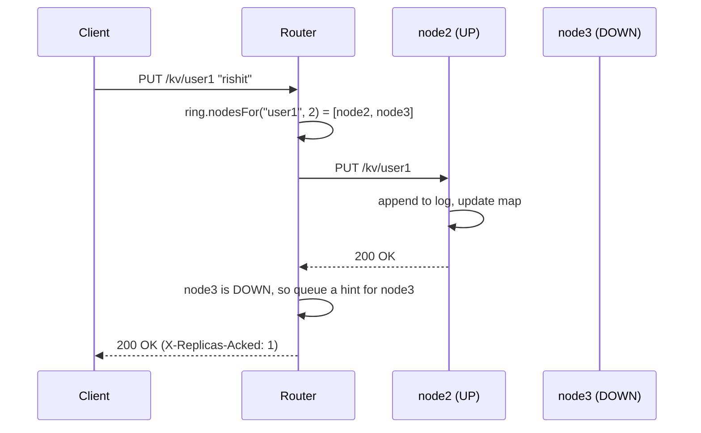

# Design

This document explains how the store works and why it is built this way.
Each section covers one part of the system, the decisions made, and their
trade-offs.

- [1. Architecture](#1-architecture)
- [2. Request flow](#2-request-flow)
- [3. Storage engine](#3-storage-engine)
- [4. Concurrency](#4-concurrency)
- [5. Partitioning with consistent hashing](#5-partitioning-with-consistent-hashing)
- [6. Replication](#6-replication)
- [7. Failure detection](#7-failure-detection)
- [8. Recovery with hinted handoff](#8-recovery-with-hinted-handoff)
- [9. Consistency: what is guaranteed](#9-consistency-what-is-guaranteed)
- [10. Monitoring](#10-monitoring)
- [11. Bugs found while building it](#11-bugs-found-while-building-it)
- [12. Limitations and next steps](#12-limitations-and-next-steps)

## 1. Architecture

```text
                         Client (curl, benchmark, ...)
                                    |
                                    v
   +----------------------------- Router ------------------------------+
   |  RouterServer     HTTP API, request counters, /cluster/status     |
   |  Coordinator      finds replicas, sends reads/writes, hints       |
   |  ConsistentHashRing  key -> list of nodes                         |
   |  HealthChecker    pings every node once per second                |
   |  ClusterNode      per node: UP / DOWN / RECOVERING + hint queue   |
   +-------------------------------------------------------------------+
            |                       |                       |
            v                       v                       v
   +---- Node 1 ----+      +---- Node 2 ----+      +---- Node 3 ----+
   | NodeServer     |      | NodeServer     |      | NodeServer     |
   | Persistent     |      | Persistent     |      | Persistent     |
   |  KeyValueStore |      |  KeyValueStore |      |  KeyValueStore |
   | WriteAheadLog  |      | WriteAheadLog  |      | WriteAheadLog  |
   +----------------+      +----------------+      +----------------+
```

- **Nodes** store data. A node knows nothing about the other nodes; it is a
  single-machine key-value server with an HTTP API.
- **The router** is the only process clients talk to. It stores no data. It
  decides which nodes hold a key, forwards requests to them, and tracks which
  nodes are healthy.
- Everything is plain Java 21 with no runtime libraries: the JDK's
  `com.sun.net.httpserver.HttpServer` for serving HTTP and
  `java.net.http.HttpClient` for calling nodes. The same jar runs as a
  node, a router, or the benchmark (`java -jar distributed-kv-store.jar node|router|bench`).

Why HTTP between components instead of a custom TCP protocol? It is easy to
debug with curl, the JDK already has a server and a client, and the router
can call nodes with exactly the same API that clients use. The cost is some
overhead per request (headers, text parsing), see [BENCHMARKS.md](BENCHMARKS.md).

## 2. Request flow

### Write (`PUT /kv/user1` with body `rishit`)

1. `RouterServer` checks the key (only `[A-Za-z0-9._:-]`, 1-256 chars) and
   reads the body (max 1 MB, otherwise `413`).
2. `Coordinator.put` takes the lock stripe for `user1` (section 4).
3. `ConsistentHashRing.nodesFor("user1", N)` returns the N replica nodes,
   for example `[node2, node3]`.
4. For each replica: if it is UP, send `PUT` to it. If it is not UP, or the
   request fails, store the write as a hint for that node (section 8).
5. If at least W replicas confirmed, answer `200 OK` with header
   `X-Replicas-Acked`. Otherwise answer `503`.

On the node, `PersistentKeyValueStore.put` appends a record to the log and
then updates the in-memory map.



### Read (`GET /kv/user1`)

1. Get the replica list for the key, same as for a write.
2. Ask the first replica that is UP. If the request fails, mark that node
   DOWN and try the next one.
3. If no replica answers, return `503`.

Reads go to one replica only. That is enough because of how recovery works
(section 9).

## 3. Storage engine

Classes: `PersistentKeyValueStore`, `WriteAheadLog`.

### In-memory map + append-only log

All data is kept in a `ConcurrentHashMap`, so reads never touch the disk.
For durability, every write is first appended to a log file (`kv.log`).
On startup the log is replayed from the top to rebuild the map.

This is the same basic idea as Redis's AOF or Bitcask: sequential appends
are the fastest way to write to disk, and the log is the source of truth.

**Order: log first, then memory.** If the process dies after the append but
before the map update, the write is recovered on restart. If it dies before
the append, the client never got an `OK`. So an acknowledged write is never
lost when the process crashes.

### Record format

One record per line:

```text
PUT <base64(key)> <base64(value)> <crc32 in hex>
DEL <base64(key)> <crc32 in hex>
```

- **Base64** so values with spaces or newlines cannot break the line format.
- **CRC32** of the rest of the line. If the process is killed in the middle of
  a write, the last line is cut off. Its checksum does not match, so replay
  skips it and logs a warning. Without the checksum, a cut-off value like
  `dmFs` (base64 of `val` instead of `value`) would be accepted as valid data.
- **Torn last line:** if the file does not end with `\n`, a newline is
  written before appending, so the next record does not get glued to the
  broken one (tested in `WriteAheadLogTest`).

### fsync

`writer.flush()` hands the data to the operating system. That survives a
process crash (`kill -9`), but not a power cut, because the OS may still hold
the data in memory. With `FSYNC=true` every write also calls
`FileDescriptor.sync()`, which waits until the disk has it. The benchmark
shows this makes writes about 12x slower (3,904 -> 322 writes/s). The default
is `false`. Replication gives another copy on a different machine anyway.

### Compaction

The log keeps every old value, so writing the same key 1,000 times leaves
1,000 records. When the log has **at least 10,000 records and more than 2x as
many records as live keys**, it is rewritten:

1. Write one `PUT` record per live key to `kv.log.compact`.
2. `fsync` the new file.
3. Rename it over `kv.log` with `ATOMIC_MOVE`.

A rename inside one directory is atomic, so after a crash there is either the
complete old log or the complete new log. The "2x live keys" rule means a
compaction (which costs O(live keys)) happens at most once every O(live
keys) writes, so the cost per write stays constant on average.

## 4. Concurrency

| Where | Problem | Solution |
|---|---|---|
| `HttpServer` | By default it runs every handler on one thread | `setExecutor(Executors.newFixedThreadPool(n))`. 16 threads per node, 32 for the router, configurable with `THREADS` |
| In-memory map | `HashMap` can lose entries or corrupt itself under concurrent writes | `ConcurrentHashMap`: each get/put/remove is atomic, reads do not block |
| Persistent store | Two writes to the same key could reach the log in one order and the map in the other, so the value after a restart would differ | `put`/`delete` are `synchronized`, so log order = map order. Reads stay lock-free |
| Router | Concurrent writes to one key could reach replica A as (x, y) and replica B as (y, x). The replicas then disagree forever | 64 lock stripes: `locks[hash(key) % 64]` is held while writing to all replicas (see section 11) |
| Request counters | Many threads increment them | `AtomicLong` |
| Node status + hints | Request threads and the health checker change them | All `ClusterNode` methods are `synchronized` |

**Why lock striping instead of one lock per key?** A map of locks per key
grows without limit and needs cleanup. A fixed array of 64 locks uses
constant memory. Two different keys only wait for each other if they hash to
the same stripe (1 in 64).

**Why `synchronized` on the store and not a `ReadWriteLock`?** Reads do not
take any lock at all (they go straight to the `ConcurrentHashMap`), so only
writers ever compete for the lock. Writers have to be serialized anyway
because they append to one file.

## 5. Partitioning with consistent hashing

Class: `ConsistentHashRing`.

### Why not `hash(key) % N`?

When N changes, almost every key maps to a different node. Measured on
100,000 keys going from 3 to 4 nodes:

| Method | Keys that move |
|---|---:|
| `hash % N` | 75.0% |
| Consistent hashing | 25.0% (the minimum: only the keys the new node takes over) |

### How the ring works

Node positions and key hashes are 64-bit numbers on a circle. A key belongs
to the first node clockwise from `hash(key)`. The ring is a
`TreeMap<Long, String>`: `ceilingEntry(hash)` finds the next node in
O(log n), and if there is none we wrap around to `firstEntry()`.

### Virtual nodes

With one point per node, the gaps between points are random, so the load is
very uneven. Each node is therefore placed on the ring 100 times (`node1#0`
... `node1#99`). Measured share of 100,000 keys across 3 nodes:

| Virtual nodes per node | node1 | node2 | node3 |
|---:|---:|---:|---:|
| 1 | 16.4% | 3.1% | 80.5% |
| 10 | 34.8% | 25.0% | 40.3% |
| 100 (default) | 28.9% | 40.0% | 31.0% |

More virtual nodes give an even spread on average, but 3 physical nodes are
still a small sample, so one node ends up with 40% of the keys here.

### Hash function

MD5 (first 8 bytes), used only because it spreads similar strings like
`key1`, `key2` evenly. It is not used for security. `String.hashCode()`
gives similar strings similar hashes, which would cluster them on the ring.

## 6. Replication

Every key is stored on **N** nodes (`REPLICATION_FACTOR`, default 2).
`nodesFor(key, N)` walks clockwise from the key and collects N **distinct**
physical nodes. Virtual nodes of an already chosen node are skipped, so two
copies never end up on the same machine.

A write is sent to all N replicas, one after the other, and succeeds once
**W** replicas confirm (`WRITE_QUORUM`, default 1). A read is served by the
first replica that is UP.

**Why W=1 by default?** The router writes to every replica anyway. W only
decides how many confirmations the client waits for. A replica that missed
a write gets it later through hinted handoff, and it is not used for reads
until then (section 8). So W=1 does not cause stale reads. It decides how
many copies exist at the moment the client gets `OK`:

- W=1: writes keep working while any one replica is up, but for a short time
  the only copy might be on one node (plus a hint in router memory).
- W=N: every acknowledged write is on all replicas, but a write fails if any
  replica is down.

**Writes that do not reach W replicas** return `503`, but the hints are kept,
so the write may still be applied later. The client should treat `503` as
"unknown outcome" and retry. That is safe because PUT and DELETE are
idempotent: doing them twice has the same effect as doing them once.

## 7. Failure detection

Classes: `HealthChecker`, `ClusterNode`.

- Every `HEALTH_CHECK_INTERVAL_MS` (1 s) the router calls `GET /health` on
  each node, with a 1 s timeout (`REQUEST_TIMEOUT_MS`).
- After `FAILURE_THRESHOLD` (3) failed checks in a row, the node is marked
  DOWN. One slow response is not enough, which avoids flapping.
- A failed client request (timeout, connection refused, unexpected status)
  marks the node DOWN **immediately**. This matters for correctness, not just
  speed: once a write to a node failed, every later write to that node must
  go into its hint queue, or the writes would reach the node out of order.
- DOWN nodes are skipped, so requests do not wait for timeouts.
- The checker runs on a `ScheduledExecutorService`. `checkAll()` catches every
  exception, because if a scheduled task throws, the executor silently stops
  running it, and failure detection would stop without any error.

This is a simple heartbeat-style detector. It cannot tell a crashed node from
a slow or partitioned one. In both cases the node is treated as DOWN, which
is safe here because recovery replays everything it missed.

## 8. Recovery with hinted handoff

Classes: `ClusterNode`, `Coordinator.recover`, `Write`.

When a write cannot be delivered to a replica, the router stores it as a
**hint** in that node's queue (`ArrayDeque<Write>`). When the node is
reachable again, the hints are replayed in order. Dynamo and Cassandra use
the same idea (they call it hinted handoff).

### Node states

```text
          request fails / 3 failed health checks
   UP -------------------------------------------> DOWN
    ^                                                |
    |  queue empty                                   | health check OK
    +--------------------- RECOVERING <--------------+
                               |
                               +---> DOWN if a replay fails
```

- **UP**: writes are sent directly, reads may use the node.
- **DOWN**: writes go into the hint queue, reads skip the node.
- **RECOVERING**: the hints are being replayed. New writes still go into the
  queue (at the end), and reads still skip the node.

The node becomes UP only when the queue is empty. So a node that is UP has
every write, and reads from it are up to date.

### Why the order of writes is preserved

- Writes to one key are serialized by the key's lock stripe in the router.
- Once a write to a node fails or is queued, the node is not UP, so every
  later write to it also goes into the queue (FIFO).
- The replay takes hints from the front, the writers add to the back.

### The race that the locking prevents

Recovery ends with "queue is empty, mark the node UP". A writer does "node is
not UP, add to queue". If these two steps could interleave, a write could be
added just after the replayer saw an empty queue but before it set UP. That
write would then sit in the queue of an UP node and never be delivered.

Both steps are `synchronized` methods on the same `ClusterNode`
(`queueIfNotUp` and `nextHintToReplay`), so they cannot interleave. Either
the write is queued before the final check, and gets replayed, or it sees
UP and is sent directly.

A hint is removed from the queue only **after** it was replayed
successfully (`peek`, send, then `poll`). If the node dies again during the
replay, nothing is lost.

### Restart with data on disk

A node that restarts keeps its data thanks to the write-ahead log. Hinted
handoff only has to fill the gap while it was down, not copy everything.
`NodeRecoveryTest` covers this: a node misses an update and a delete,
restarts, catches up, and then serves the correct data when the other
replica is down.

## 9. Consistency: what is guaranteed

With one router that has not restarted:

- **A read never returns data older than the last acknowledged write to that
  key.** Writes go to every UP replica before the client gets `OK`, and a
  replica that missed a write is not UP until it has replayed it.
- **Replicas converge.** Every write reaches every replica, directly or
  through a hint, in the same order.
- **When in doubt, the router returns `503` instead of stale data.** If all
  replicas of a key are DOWN or RECOVERING, reads of that key fail until one
  is UP again.

What is **not** guaranteed:

- **Router restart:** hints are kept only in memory, so they are lost if the
  router restarts. A node that was down at that time may then serve stale
  data.
- **Multiple routers:** the per-key ordering relies on one router. With
  several routers, two of them could send writes to the replicas in
  different orders. Real systems solve this with versions on each value
  (timestamps or vector clocks) plus conflict resolution.
- **A read during a write** to the same key can see either the old or the
  new value.

In CAP terms the system leans towards consistency: it rejects reads it
cannot serve correctly. Writes stay available as long as W replicas are up.

## 10. Monitoring

- Each node: `GET /stats` returns the key count, get/put/delete counters
  and uptime.
- Router: `GET /cluster/status` returns the replication settings, router
  request counters, and for every node its status, pending hints and
  `/stats` (skipped for DOWN nodes, so the status call does not wait for
  timeouts).
- Dashboard (`dashboard/`, Next.js): one page that polls every 2 seconds.
  The browser calls the dashboard's own `/api/status` route, which fetches
  the router's status on the server side. So the router needs no CORS
  configuration, and its address is set at runtime with `ROUTER_URL`
  (`http://router:8080` inside Docker).
- JSON is built with a `StringBuilder`. The objects are small and have a
  fixed shape, so a JSON library is not needed. `Json.quote` escapes strings.

## 11. Bugs found while building it

**40 ms per request (Nagle's algorithm).** Requests through the router often
took about 44 ms while a direct request to a node took about 1 ms. A delay
of roughly 40 ms is typical of Nagle's algorithm (which holds back small TCP
packets) interacting with delayed ACKs (the receiver waits up to ~40 ms
before acknowledging). The JDK `HttpServer` leaves Nagle on. Setting
`sun.net.httpserver.nodelay=true` (TCP_NODELAY) before the first server is
created fixed it: 300 sequential PUTs went from 13.3 s to 1.2 s. See
`HttpUtils`.

**Replicas diverging under concurrent writes.** A test where 8 threads wrote
the same 20 keys left the two replicas of some key with different values in
2 of 4 runs. Thread 1 wrote node A, thread 2 wrote node A and node B, then
thread 1 wrote node B, so A had thread 2's value and B had thread 1's.
Holding a per-key lock stripe while writing all replicas fixed it (4 of 4
runs pass). See `ReplicationTest.concurrentWritesToSameKeysLeaveReplicasIdentical`.

## 12. Limitations and next steps

| Limitation | Possible fix |
|---|---|
| The router is a single point of failure | Run several routers behind a load balancer. That needs versioned values (last-write-wins timestamps or vector clocks) so replicas can resolve conflicting writes |
| Hints live only in router memory and the queue has no size limit | Persist hints to disk and cap the queue. Past the cap, repair the node with anti-entropy (compare replicas, e.g. with Merkle trees, and copy the differences) |
| Membership is static (`NODES` at startup), nothing moves data when a node is added | Add a join/leave API that streams the affected key ranges to their new owners |
| Writes go to replicas one after the other | Send them in parallel with `HttpClient.sendAsync` and wait for W answers |
| Every key must fit in memory on its nodes | Keep only an index in memory and read values from the log file (like Bitcask) |
| `FSYNC=true` is slow | Group commit: fsync once for a batch of writes |
| Keys are limited to `[A-Za-z0-9._:-]` | URL-encode keys in the router and decode them on the node |
| No authentication or TLS | Put the cluster in a private network, add TLS and an API token |
